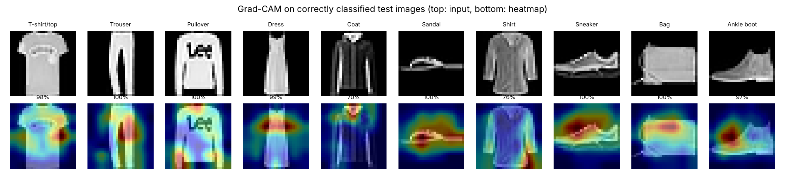
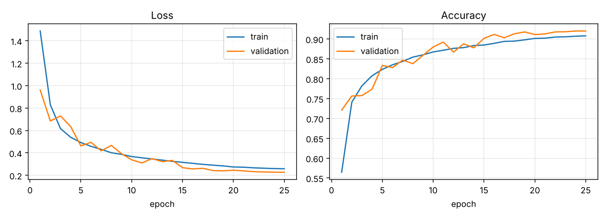
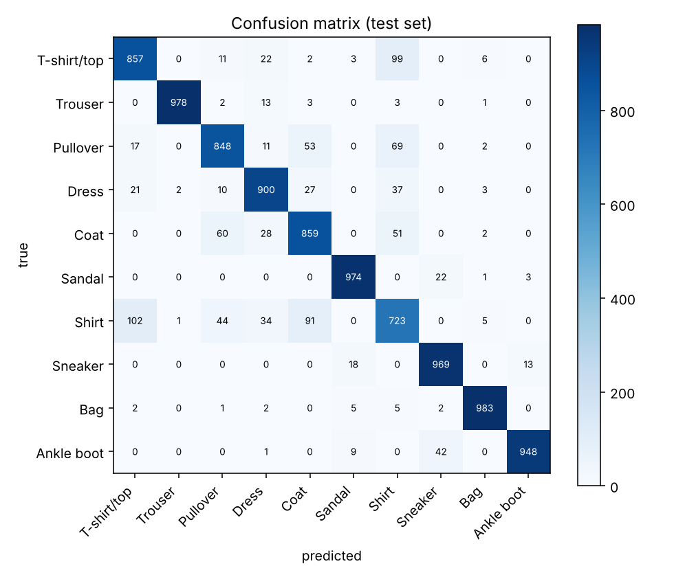

# Fashion-MNIST CNN Classifier with Grad-CAM, Streamlit and Supabase

A PyTorch convolutional neural network (CNN) that classifies 28×28 grayscale clothing images into
the 10 **Fashion-MNIST** categories, explains each prediction with a **Grad-CAM** heatmap, and logs
predictions to a **Supabase** (Postgres) database. Everything runs in one **Streamlit** app.

> **Result:** 90.4% test accuracy on the 10,000-image Fashion-MNIST test set with a
> 94,186-parameter CNN (25 epochs, about 12 minutes on a laptop CPU).

**Live demo:** [add your Streamlit link here]



---

## What the app does

| Tab | What you can do |
|---|---|
| **Classify** | Pick one of 20 held-out test images or upload your own photo. See what the model sees (28×28), the Grad-CAM heatmap, and the top-5 class probabilities. Each prediction is logged to Supabase. |
| **Model results** | Test accuracy, training and validation curves, an interactive confusion matrix, and per-class precision and recall. |
| **Recent predictions** | The latest 200 predictions from Supabase, with a class histogram. |
| **How it works** | The data, model, Grad-CAM, upload preprocessing and privacy, in plain language. |

## Results

| Metric | Value |
|---|---|
| Test accuracy (10,000 images, scored once) | **90.4%** |
| Best validation accuracy (5,000 held-out training images) | 92.0% |
| Parameters | 94,186 |
| Training | 25 epochs, AdamW, one-cycle learning rate (max 0.002), batch 128, flips + 2-pixel shifts |

Per-class recall (test set):

| Class | Precision | Recall |
|---|---|---|
| T-shirt/top | 85.8% | 85.7% |
| Trouser | 99.7% | 97.8% |
| Pullover | 86.9% | 84.8% |
| Dress | 89.0% | 90.0% |
| Coat | 83.0% | 85.9% |
| Sandal | 96.5% | 97.4% |
| Shirt | 73.3% | 72.3% |
| Sneaker | 93.6% | 96.9% |
| Bag | 98.0% | 98.3% |
| Ankle boot | 98.3% | 94.8% |

**Hardest class:** Shirt (recall 72.3%). Shirts look like T-shirts, pullovers and coats at 28×28, so
these classes absorb most of the errors (see the confusion matrix).

<details>
<summary>Training curves and confusion matrix</summary>



</details>

## How it works

**Model.** Three convolution blocks (3×3 convolutions, batch normalization, ReLU; 2×2 max pooling
after the first two), then global average pooling, dropout (0.3) and one linear layer.
Feature maps: 28×28×32 → 14×14×64 → 7×7×128.

**Grad-CAM** (Selvaraju et al., 2017). For the predicted class, the gradient of its score with
respect to the last convolution block's 128 feature maps says how important each map is. The
weighted sum of the maps, passed through ReLU and upsampled from 7×7 to 28×28, is the heatmap.
Red areas pushed the model toward that class. It explains this model's decision, not human vision.

**Uploads.** Fashion-MNIST items are light garments on a black background; ordinary photos are
usually the opposite, which confuses the model. Uploads are converted to grayscale, **inverted
automatically when the border is brighter than the centre**, padded to a square and resized to
28×28. You can switch auto-invert off in the app to see the difference.

**Supabase.** The app uses the public *anon* key, which can only insert predictions and read a
hash-free view (row-level security in [`supabase/schema.sql`](supabase/schema.sql)). Images are
never stored: a prediction row holds a SHA-256 hash of the image, the predicted class, the
confidence and the 10 probabilities. Training runs can be logged with a separate service key that
stays on your PC.

```
Streamlit app (app.py)
 ├─ CNN + Grad-CAM (src/)            runs inside the app, CPU is enough
 └─ Supabase REST API, anon key ──►  predictions (insert only) · recent_predictions view · runs
train.py (your PC, GPU if available) ─ service key (.env) ──► runs
```

## Run it on your PC (Windows PowerShell)

```powershell
python -m venv .venv
.venv/Scripts/Activate.ps1              # macOS/Linux: source .venv/bin/activate
# Optional, NVIDIA GPU: install CUDA PyTorch first (https://pytorch.org/get-started/locally/), e.g.
#   pip install torch --index-url https://download.pytorch.org/whl/cu128
pip install -r requirements-dev.txt

streamlit run app.py                    # uses the trained model already in models/
```

To retrain the model yourself (downloads Fashion-MNIST into `data/` on first run, ~30 MB):

```powershell
python train.py                         # prints "Training on: cuda" if the GPU is used
python tools/export_samples.py          # (re)creates the 20 sample images
pytest -q                               # 6 tests: model, Grad-CAM, preprocessing, data split
```

Training takes about 2 minutes on an RTX-class GPU and about 12 minutes on a laptop CPU.

## Supabase setup (optional, ~5 minutes)

The app works without Supabase; logging and the *Recent predictions* tab just stay off.

1. Create a free project at [supabase.com](https://supabase.com).
2. **SQL Editor → New query**, paste [`supabase/schema.sql`](supabase/schema.sql), click **Run**.
3. **Project Settings → API**: copy the **Project URL** and the **anon public** key.
4. Copy `.streamlit/secrets.toml.example` to `.streamlit/secrets.toml` and paste them in.
5. Restart `streamlit run app.py`, classify an image, and check the **Recent predictions** tab.

To also record training runs: copy `.env.example` to `.env`, add the **service_role** key, and run
`python train.py --log-supabase`. Never commit `.env` or `secrets.toml` (both are git-ignored), and
never put the service key in Streamlit.

## Deploy on Streamlit Community Cloud (free)

1. Push this repo to GitHub (including `models/`, `results/` and `assets/`).
2. At [share.streamlit.io](https://share.streamlit.io): **Create app** → pick the repo → main file
   `app.py` → **Advanced settings**: Python 3.12, and paste the two lines from your
   `secrets.toml` into **Secrets**.
3. Deploy, then put the link at the top of this README.

## Project structure

```
app.py                     Streamlit app (4 tabs)
train.py                   training, evaluation, figures, optional Supabase run logging
src/data.py                Fashion-MNIST download (with MD5 check), loading, stratified validation split
src/model.py               the CNN
src/gradcam.py             Grad-CAM
src/preprocess.py          upload preprocessing (grayscale, auto-invert, pad, resize, normalize)
src/supabase_log.py        tiny Supabase REST client (requests only)
supabase/schema.sql        tables, row-level security, hash-free view
tools/export_samples.py    saves 2 test images per class for the app
models/fashion_cnn.pt      trained model (~0.4 MB)
results/                   metrics.json and figures from the training run
assets/samples/            20 held-out test images
tests/test_core.py         pytest suite
```

## Limitations

- **Distribution shift.** The model only knows centred, single garments on plain dark
  backgrounds. Auto-invert fixes the most common mismatch (white backgrounds), but busy photos,
  several items, people wearing the clothes or unusual angles can still get confident wrong answers.
- **Grad-CAM is coarse.** The heatmap comes from a 7×7 layer, so it shows regions, not exact pixels.
- **Single training run.** Results are from one seed; expect about ±0.3% between runs.

## Origin and acknowledgments

This is my own rebuild of a group project from my deep learning class,
[See-Sense](https://github.com/emmabellerogo/see-sense), which I built with a teammate (Streamlit UI,
FastAPI model API on Render, Supabase). This version is a fresh, simplified implementation written
from scratch: one Streamlit app instead of a separate API, a new CNN with batch normalization,
automatic inversion of light-background uploads, and a lighter Supabase integration.

Built with help from [Claude Code](https://claude.com/claude-code) (Anthropic), which assisted with
writing the code and documentation. I ran the training and tested the app, and I'm responsible for
the results.

**Dataset:** Fashion-MNIST, Xiao, Rasul & Vollgraf (2017),
[github.com/zalandoresearch/fashion-mnist](https://github.com/zalandoresearch/fashion-mnist), MIT License.
**Grad-CAM:** Selvaraju et al. (2017), *Grad-CAM: Visual Explanations from Deep Networks via
Gradient-based Localization*, ICCV.
